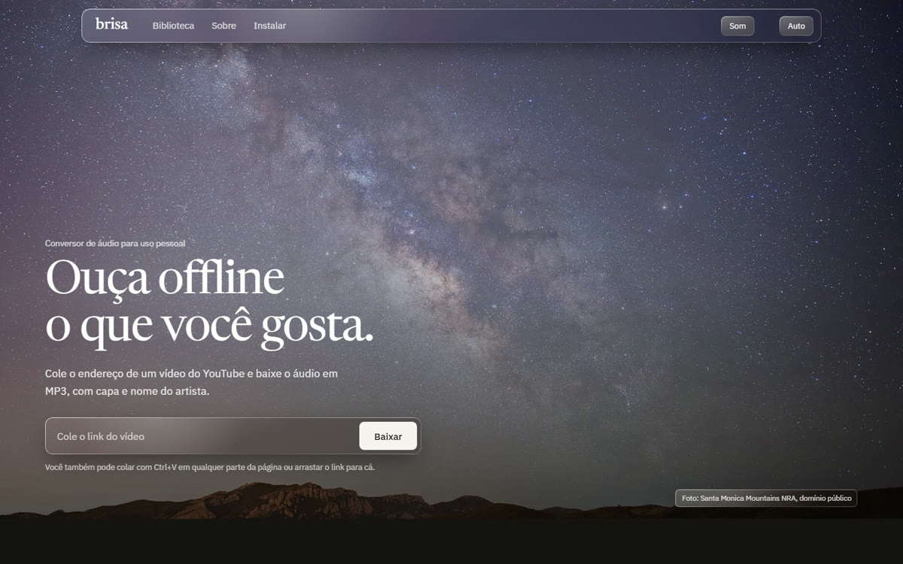

# brisa

Baixe o áudio de vídeos do YouTube em MP3, com capa e nome do artista, por uma
página bonita que roda no seu próprio computador.



## O que ela faz

- **MP3 a 320 kbps** a partir da melhor faixa de áudio disponível
- **Capa e metadados**: a miniatura do vídeo vira a capa; título e canal vão para o arquivo
- **Biblioteca com prévia**: suas músicas aparecem como discos de vinil e tocam direto na página
- **Progresso real**, inclusive no ícone e no título da aba
- **Atalhos**: cole com `Ctrl+V` em qualquer lugar ou arraste o link para a página
- **Foto do topo muda com o horário** (amanhecer, dia, fim de tarde e noite) e o tema escuro liga sozinho à noite
- **Vini**, o mascote, reage a cada etapa do download, e um som curto avisa quando termina (dá para desligar)
- **Tudo local**: sem anúncio, sem cadastro, nada é enviado para servidores de terceiros

## Instalação

Você precisa de **Python 3.10+** e do **ffmpeg**.

| Sistema | ffmpeg |
|---|---|
| Windows | `winget install Gyan.FFmpeg` |
| macOS | `brew install ffmpeg` |
| Linux (Debian/Ubuntu) | `sudo apt install ffmpeg` |

Depois:

```bash
git clone https://github.com/dssxz120-cyber/brisa.git
cd brisa
pip install -r requirements.txt
python app.py
```

Abra **http://127.0.0.1:5000** no navegador.

## Uso pelo terminal

Sem a página, direto no terminal:

```bash
python baixar_musica.py                      # modo interativo: cola os links um por um
python baixar_musica.py LINK1 LINK2 LINK3    # baixa vários de uma vez
```

As músicas ficam na pasta `musicas/`.

## Configuração

| Variável de ambiente | Padrão | O que faz |
|---|---|---|
| `BRISA_PASTA` | `./musicas` | Pasta onde as músicas são salvas |
| `BRISA_PORTA` | `5000` | Porta do servidor local |

## Problemas comuns

- **Parou de baixar**: o YouTube muda com frequência. Atualize com `pip install -U yt-dlp`.
- **"ffmpeg não encontrado"**: instale o ffmpeg (tabela acima) e abra um terminal novo.
- **Sem capa na biblioteca**: a capa é extraída do MP3 pelo ffmpeg; confira se ele está instalado.

## Segurança

A Brisa foi feita para rodar **só no seu computador**:

- o servidor escuta apenas em `127.0.0.1` e recusa pedidos endereçados a outros nomes (proteção contra *DNS rebinding*);
- downloads só são aceitos vindos da própria página;
- só links com domínios exatos do YouTube são aceitos;
- a página usa Content-Security-Policy e outros cabeçalhos de proteção.

Não exponha o servidor na rede ou na internet. Encontrou uma falha? Abra uma
*issue* sem detalhes do ataque e peça um contato privado.

## Contribuindo

Sugestões e *pull requests* são bem-vindos:

1. Faça um *fork* e crie um branch (`git checkout -b minha-melhoria`)
2. Faça as mudanças e teste rodando `python app.py`
3. Abra um *pull request* explicando o que mudou

Estrutura do projeto:

```
app.py             servidor web (Flask) e API
baixar_musica.py   download e conversão (yt-dlp + ffmpeg); também funciona sozinho no terminal
templates/         página
static/            estilo, JavaScript e fotos
```

## Uso responsável

Este projeto é para **uso pessoal**. Baixe apenas conteúdo que você tem direito
de baixar e respeite os [Termos de Serviço do YouTube](https://www.youtube.com/t/terms)
e os direitos dos artistas. O projeto não é afiliado ao YouTube nem ao Google, e
os autores não se responsabilizam pelo uso que cada pessoa faz dele.

## Licença

O código está sob a [licença MIT](LICENSE).

As fotos em `static/img/` vêm do Wikimedia Commons e mantêm as licenças
originais (domínio público, CC BY 2.0 e CC BY 3.0). Veja os autores em
[static/img/CREDITOS.md](static/img/CREDITOS.md).

Feito com [yt-dlp](https://github.com/yt-dlp/yt-dlp), [ffmpeg](https://ffmpeg.org) e [Flask](https://flask.palletsprojects.com).
